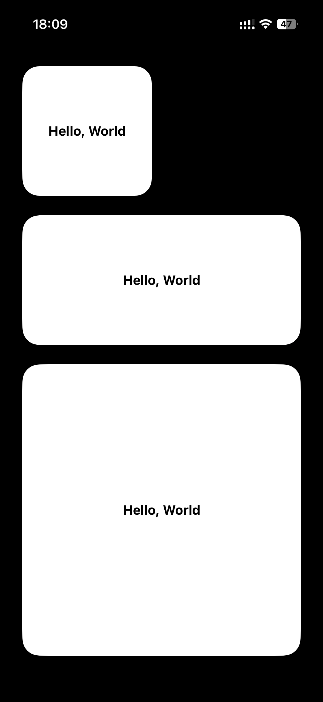
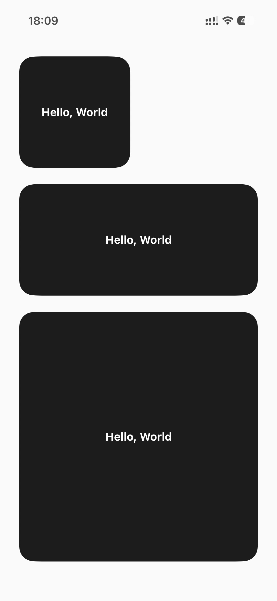
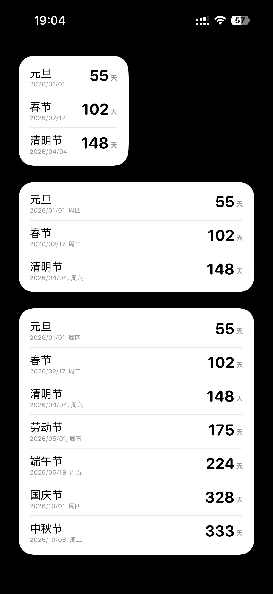
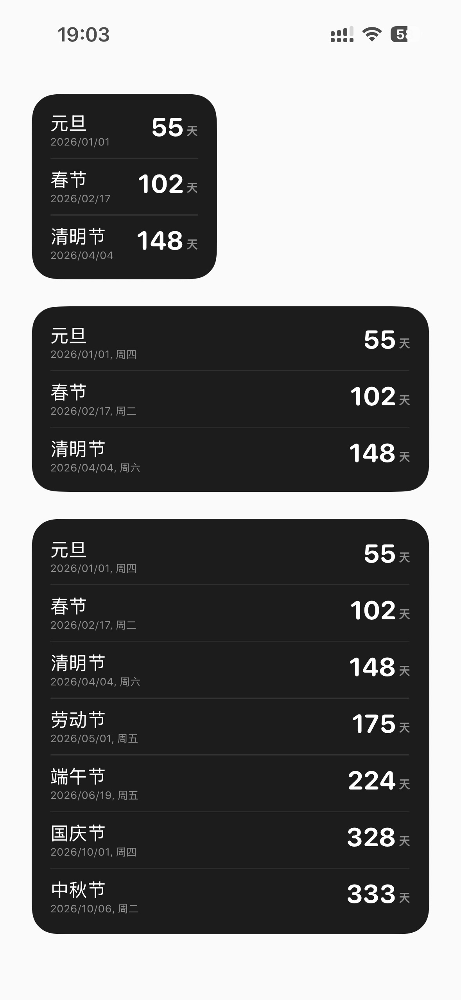
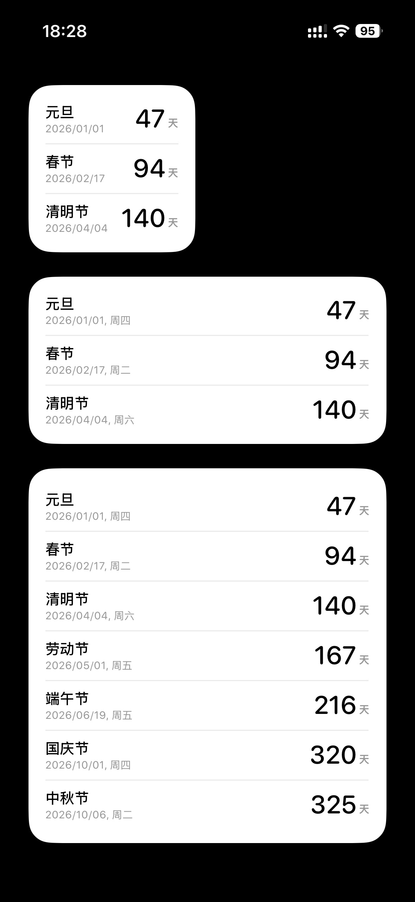
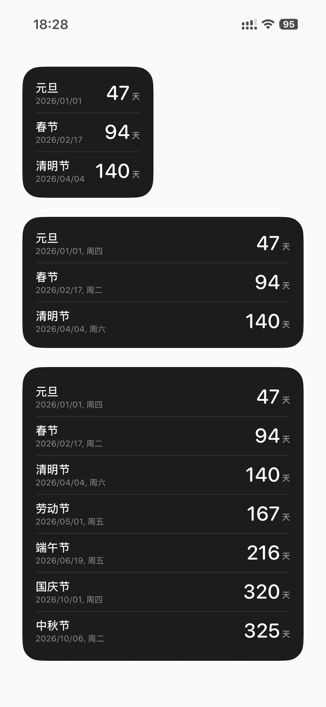

# Open-source Scriptable scripts for iOS Widgets

参考文档：

- [Scriptable API 文档](https://docs.scriptable.app/)

## 使用示例

```javascript
// 配置
const config = {
  name: 'World',
};
// 加载脚本
const url = 'https://cdn.jsdelivr.net/npm/@showlotus/open-scriptable@latest/dist/hello-world.js';
const code = await new Request(url).loadString();
// 执行脚本
const render = new Function(code)();
await render(config);
```

<div>
  
  
</div>

## 组件列表

### 倒计时组件

```js
const url = 'https://cdn.jsdelivr.net/npm/@showlotus/open-scriptable@latest/dist/count-down.js';
const code = await new Request(url).loadString();
const render = new Function(code)();
await render();
```

小组件参数格式：`日历类型,布局`（逗号分隔，中英文逗号均可，两段均可选）

- **日历类型**：只显示指定类型的日历事件，多个类型用 `/` 分隔（如 `节假日/生日`），留空显示全部
- **布局**：`double` 为两列布局（中号 2 列 × 3 行、大号 2 列 × 7 行），默认 `single` 单列
- 只传一段时，若为 `single`/`double` 关键词则视为布局，例如直接填 `double` = 全部日历 + 双列

示例：小组件参数填写 `节假日,double`

使用指南：[【iOS】倒计时小组件可以自动关联日历啦✨ - showlotus](https://www.xiaohongshu.com/discovery/item/693ad4e1000000001b0213f9?source=webshare&xhsshare=pc_web&xsec_token=AB7rXUtVvD9i-FRNDkZ48ctiVz2JxS_fcZY2waWv-enoA=&xsec_source=pc_share)

<!-- <div>
  
  
</div> -->

<div>
  
  
</div>

<!-- ### 月度消费组件 -->

## 开发

```bash
# 安装依赖
pnpm install

# 启动开发服务器
pnpm dev
```

在 Scriptable 中加载 `http://192.168.5.6:3000/src/hello-world.ts` 脚本，即可看到效果。

```js
// 加载脚本
const url = 'http://192.168.5.6:3000/src/hello-world.ts';
const code = await new Request(url).loadString();
// 执行脚本
const render = new Function(code);
await render();
```
